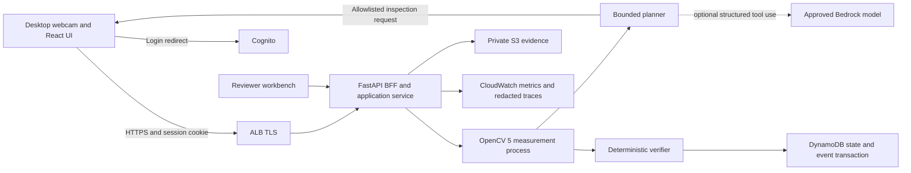

# Architecture blueprint

Design status: implementation started, incomplete; [build status](docs/BUILD-STATUS.md) owns actual source/test coverage. One business per deployment. Use a modular monolith with one bounded planner and an independent deterministic verifier; no multi-agent runtime or distributed workflow engine.

## Concrete stack and modules

React + TypeScript + Vite for two surfaces, FastAPI/Pydantic on Python 3.12 for the application, pytest/Hypothesis for backend tests and Playwright for browser journeys. Resolve supported current frontend/runtime versions at bootstrap; commit lockfiles and hashes, not floating latest dependencies. OpenCV 5.0 baseline candidate must pass actual import/function tests. A pinned upstream source build is the fallback if a suitable wheel is unavailable. No silent substitution of OpenCV 4.

Directories: `apps/web`, `services/api/proofpack/{auth,recipes,vision,planner,verifier,evidence,review}`, `tests/{unit,contract,integration,e2e,eval}`, `infra`, `scripts`, `fixtures/{synthetic,printable,physical}`. Foundation source exists; infrastructure, fixtures and integration coverage remain incomplete as recorded in build status.

Serve built frontend and `/api/v1` from the same application origin. No tokens in localStorage. BFF handles Cognito code flow, rotates opaque HttpOnly sessions and keeps provider tokens server-side. A public `/health/live` reveals only liveness; authenticated admin runtime endpoint reveals version/build identity without secrets.

## Deployment topology

Start with one EC2 Graviton4 service instance and a replaceable launch template, ALB/ACM, DynamoDB, private S3 and Cognito. Baseline OpenCV works independently of optional COOL. COOL Marketplace AMI execution stays on its supported host; do not assume its licensing permits repackaging in Fargate. Application runs as a non-root systemd service in an isolated Python environment; decoder/CV work runs in a bounded child process. Provisioning artifacts will use CloudFormation and a versioned installation script.

The ALB is the only public application listener. EC2 security-group inbound permits the ALB service port only; no SSH. Systems Manager administers the machine. A public IPv4 for outbound access is an explicit cost-sensitive beta option, not open application access. Compare it with NAT/private endpoints before deployment. Application and record stores remain single-region; no multi-region writes.

## Transaction boundary

DynamoDB is authoritative for inspection version, station fence, active recipe/calibration/policy and current status. Do not keep authorization truth solely in process memory. A successful verification transaction condition-checks current station/recipe/policy bindings, conditionally updates inspection version and writes the event once. Avoid a separate ConditionCheck and Update on the same item. An S3 upload is outside this transaction: upload selected evidence to a server-chosen immutable key, validate it, then link it in the commit; reconcile orphan uploads and incomplete evidence without claiming success.

Historical evidence is immutable by normal application writes but deletable through an audited privacy workflow. Hashes support integrity checks, not truth of capture or protection from a privileged administrator. Current result reads validate expiration and all bindings with strongly consistent reads; TTL cleanup never controls authorization.

## Lifecycle authority

Current reads and sensitive writes bind originating session/membership, runtime/control and data-authority epochs as well as recipe/calibration/policy and station fences. Restart/stop/grant or purpose change cannot restore old authority; data-dependency receipts are revalidated before fresh publication. Deployment capacity and optional inference reservations are durable, scoped and idempotent. Private evidence uses authenticated app-proxied delivery. Complete persona/operation/case coverage is in [workflow acceptance](docs/WORKFLOW-COVERAGE.md); full workflow acceptance remains NOT_RUN; BUILD-STATUS owns partial local implementation evidence.

## Deliberate simplifications

No Redis, Kafka, vector database or job fleet. Frame requests are synchronous with bounded concurrency and latest-frame replacement. A separate same-host maintenance worker handles export/deletion/evaluation jobs with durable leases; it cannot issue live passes. Scaling is deferred until the two-station workload is measured. A single-instance beta has downtime risk and no HA claim; supervised sessions stop on outage.

## Design decisions to verify

Validate end-to-end freshness on the real network, ARM library compatibility, camera noise/glare tolerance, correct atomic invalidation and Cognito account flows. Test two concurrent tabs/stations and process restart. Source-specific facts and references live in [sources](docs/SOURCES.md); implementation detail is a design choice, not an AWS guarantee.

## Current configured composition boundary

`runtime/composition.py` implements explicit typed service construction under one repository/access/runtime authority and shared worker registry. Construction performs no SDK request or worker spawn. Configured lifespan checks OpenCV and fixed role/table target metadata before disabled runtime startup, and owns its resource cleanup; a missing selected capture purpose leaves publication unconfigured. The default module entrypoint remains unavailable for protected workflows. No environment/request-controlled identity bypass, first-owner grant or automatic readiness is introduced. The factory is a local integration component; actual private host configuration/invocation, deployment/provider/IAM/storage/recovery and complete F1-F5 acceptance remain separate requirements. See AWS-DEPLOYMENT and STATE-DATA-API for the exact contract.

## Installed host and frontend boundary

`runtime/host.py` supplies strict private-file validation and explicit one-worker serving for the planned EC2 role; it creates SDK clients only for an admitted serve invocation. Configuration/keys remain separated and closed-schema, with no request-controlled provider/credential/endpoint override. `setup.py` copies only a complete bounded prebuilt frontend into the Python package; installed app assets take precedence over the checkout fallback. The full verifier builds frontend before wheel and proves an isolated offline installation with exact asset hashes. These are implemented local mechanisms; actual host installation, secure private config, IAM/TLS/provider/operational evidence and full workflow acceptance remain external/open requirements.

## Inspection export implementation boundary

`evidence/exports.py` now prepares leased bounded historical manifests; `export_http.py` and kind-based job dispatch connect creation, inspection-scoped discovery, progress, cancellation and session-bound ticket delivery. `ExportPanel.tsx` provides explicit operator/reviewer controls. The canonical manifest is a separate bounded DynamoDB row; source ZIP bytes are assembled in memory from freshly authorized pinned originals, with no additional stored S3 archive. Source record mutations require the existing inspection/data-authority invalidation discipline; selected media also has direct current row/purpose checks.

A separate non-daemon same-host maintenance thread now composes the existing export, selected-asset cleanup and dataset metadata executors, signed originating-session resolution, bounded rotating discovery, durable step admission and current-runtime/lease/cancellation fences. It starts only after target/runtime startup when explicitly configured. Composition owns shared resources once; stop checkpoints prevent subsequent phases, bounded drain precedes cleanup, and a drain timeout fails shutdown and defers cleanup until processing exits. Owner diagnostics are read-only and expose no private job/session references. Complete local verification passes 1018 Python/113 Chrome/ten gates; evaluation jobs, automatic full retention/orphan recovery, actual AWS/ARM, complete privacy/F5 and human acceptance remain outstanding.

The optional-improvement permission service reuses scoped retained-asset metadata and current operational-purpose authority, with a separate notice, owner/session-bound review, immutable hashed grant and withdrawable head. Commit/withdraw advances DATA; future F5 consumers must reauthorize exact current source scope/notice/expiry and reviewer permission. Operational grants, label truth and publicity flags are not widened. Original notice terms remain inspectable after a configuration change. No dataset, training, replay, evaluation or promotion job is created by recording a permission; those full F5 workflows remain unfinished.

Dataset manifests use the same maintenance thread with signed original-reviewer authority. A bounded canonical request can select up to 1000 examples; one example and its group conditions are committed per nonrenewable step. Immutable entries form an ordered hash chain and a sealed header under current DATA/configuration/deadline/runtime. Runtime replacement revalidates a partial prefix without refunding attempts. Persistent hashed group assignments and explicit owner declassification prevent split upgrades; delivered request/example metadata is audited. These mechanisms neither supply actual untouched/independent evidence nor implement replay/evaluation/promotion.

Installed policy candidates live in planner/candidates.py and candidate_http.py with explicit policy_catalog host/config bounds. Source-free immutable proposal metadata shares the existing repository/access/runtime services and never writes policy-active. PolicyPanel serves reviewer preparation and owner metadata review; full evaluation/promotion and live integration are separate unfinished boundaries. The default installed ordering preserves existing live deterministic selection.
