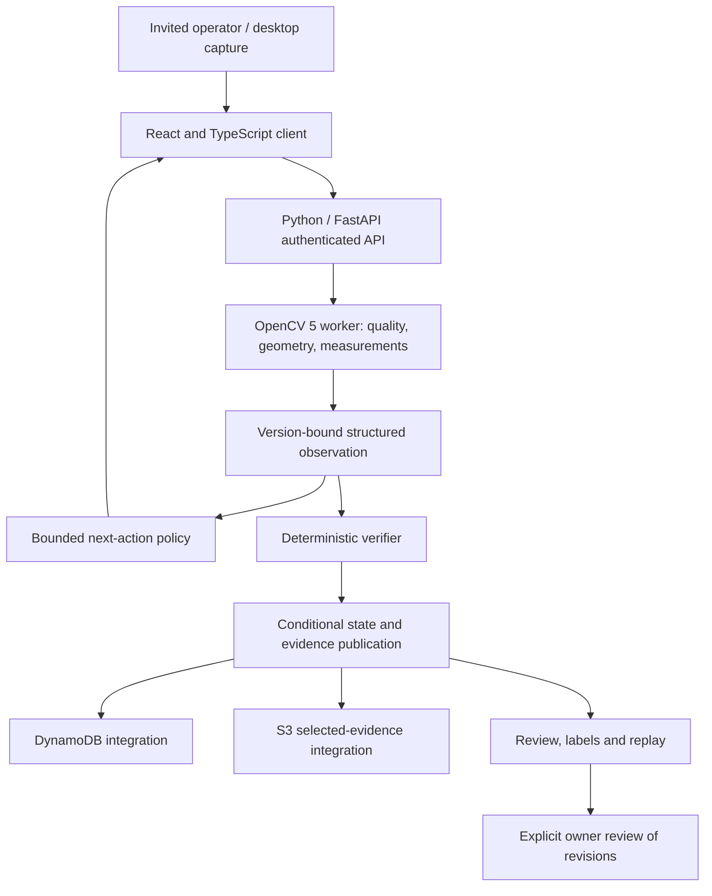

# ProofPack — technical report

October 19, 2026. Prototype checkpoint, not a claim of completed contest requirements or beta readiness.

## Problem and intended users

ProofPack assists with checking configured visible kit contents. The first target is one business with invited operators and desktop webcams. Overlap, uncertainty and changes after an inspection can make a single photograph insufficient. The proposed benefit is clearer next steps and reviewable evidence. No packing operators or physical kits have been available for independent evaluation; productivity, accuracy in physical use and demand are unproven.

## Five connected capabilities

1. Recipe and camera enrollment binds expected parts, calibration, qualification and approval to versions. Synthetic qualification does not authorize physical recipes.
2. OpenCV measurement checks image quality, rectifies a calibrated plane, measures supported visible features and detects scene changes. Unobservable properties remain unknown.
3. Active inspection selects bounded recapture, separation, placement or review actions from structured findings. Fresh observations are required after correction; optional model proposals have no pass authority.
4. A deterministic verifier checks current bindings and evidence before proposing an outcome. Conditional persistence, expiry and invalidation prevent reuse of stale results. Historical records do not authorize shipping.
5. Outcome review and replay preserves label revisions and development/validation/frozen-test separation. Promotion requires reviewed evidence; no demonstrated learning advantage is claimed.

Local implementations and selected tests exist. Full workflow acceptance, privacy cleanup and operational recovery remain incomplete.

## Architecture

The diagram describes implementation boundaries and AWS integration intent. Current selected native proof uses DynamoDB Local, synthetic identity and intercepted S3. It is not a diagram of a verified live deployment. The optional model adapter is constrained to allowed actions; it cannot modify recipes, run arbitrary tools or grant a pass. Actual provider invocation is not established here.

## OpenCV and AWS evidence

The project pins opencv-python 5.0.0.93. Its retained local runtime receipt reports cv2 5.0.0 on Windows/Python 3.12.3 with a loaded-library hash. Substantive vision is part of the measurement path, not merely a project tag. The latest selected native integration uses actual local CV publication. A version print alone is insufficient to demonstrate the complete task.

Meaningful execution on actual AWS is still missing. The integration design uses DynamoDB conditional state, selected evidence storage in S3 and configured access/runtime controls. Actual target, budget, deployment approval and cloud receipts remain unresolved. COOL and Graviton/Arm execution or speedups are not claimed.

## Verification and exact claim scope

| Evidence checkpoint | Observed result | Limit |
|---|---|---|
| Current rollover source tests | Six cases / 18 phases passed | Metadata quota/retry/clock semantics, not CV accuracy |
| Same installed-package rollover tests | Same six cases / 18 phases passed | Local installed Windows environment |
| Current selected native integration | Three cases / nine phases passed | Actual local CV and DynamoDB Local; synthetic identity and intercepted S3 |
| Native SDK boundary | 6,132 loopback requests; zero external requests | Establishes emulator isolation, not AWS delivery |
| Earlier owner-metadata checkpoint | 645 source cases, 592 installed backend cases, 54 browser cases | Scoped earlier source subject; browser responses synthetic/intercepted |
| Current full collection | 6,539 collected identities | Collection only; full current execution NOT_RUN |
| Physical/operator and adoption evaluation | NOT_RUN / blocked by access | No accuracy, speed, savings or adoption claim |

Counts are not additive. Earlier evidence is not relabeled as a fresh complete-suite run. The original modeled clock setup failure was retained and corrected using a genuine earlier login; a separate case preserves the earlier authentication denial. Native startup initially held below unchanged memory floors; later admission allowed one bounded run. Unknown historic browser/timing causes and independent oracle reviews remain open.

Current runtime wheel SHA256: `043da736b118f72ce03e7a979a31a6266f0d6cff41f411eccded62d4cb50bff3`. Latest test subject: `07574788f8ba4383a6f35e47f27748edfd0a39838a4b1759f9f237891156a2e1` (840 inputs). Runtime bytes remained unchanged for the test-only rollover checkpoint. This report adds documentation and does not redefine that subject.

## Evaluation still required

Freeze independently reviewed physical kit/session/operator groups and exact software/configuration. Compare with a manual checklist and a fixed inspection policy under equal action and capture budgets. Record complete-task time, false passes, false holds, retakes, assistance, uncertainty, failure cases and cost. Record setup/support effort separately. Keep synthetic and physical populations separate and do not turn planned thresholds into achievements. A trace for Agentic Vision must show a visual finding changing the later action and a fresh observation changing the result.

## Reproduction and judge access

Dependencies are pinned in requirements.txt, requirements-dev.txt and package-lock.json. Python requires 3.12; current resolved runtime is Windows. Node/npm supports the React build; Java and the pinned DynamoDB Local distribution are prerequisites for native local integration. Start with docs/DEVPOST-SUBMISSION.md testing instructions in the source repository: https://github.com/vijay-v-bhoyar/ProofPack (created private; judge access still required). Video and endpoint or arranged screen-share are missing. This report alone is not a source archive or runnable demo. The repository excludes large generated execution workspaces and dependency bundles; nested raw-run references in retained evidence may remain local-only.

Deployment requires the approved host configuration, artifact identity, IAM access and budget documented in docs/AWS-DEPLOYMENT.md and docs/OPERATIONS.md. Do not substitute local emulator success for AWS acceptance or reuse an obsolete handoff bundle.

## Responsible use and limitations

ProofPack checks configured visible contents only. It cannot authenticate camera pixels, infer hidden properties, certify product safety or authorize shipping. Manual checking remains necessary. Retain selected evidence according to actual approved purposes and retention; production privacy/cleanup completion remains pending. Do not use customer shipping labels or personal data in demonstrations. Uploaded code/data/model/media rights and team eligibility must be verified before final submission.

Codex assisted with implementation, documentation, tests and diagnosis. This is disclosed separately from the proposed application-level agent loop. No customer validation, AWS run, COOL benchmark or performance improvement is invented. Product status remains PARTIAL; beta NO_GO.

## Source register

Local source of truth: docs/BUILD-STATUS.md; docs/FEATURE-SPECS.md; docs/OPENCV-PIPELINE.md; ARCHITECTURE.md; requirements.txt; evidence/local/opencv-runtime.json; .loop/repairs/metadata-native-rollover/verification-current-v4.json; .loop/repairs/owner-metadata-v6/verification-current-v1.json. These are provenance references within the project, not public URLs or attachments implied to be included with this standalone report.

Contest requirements and rubric were read from https://opencv26.devpost.com/ and https://opencv26.devpost.com/rules on October 19, 2026. Final submission remains pending.
